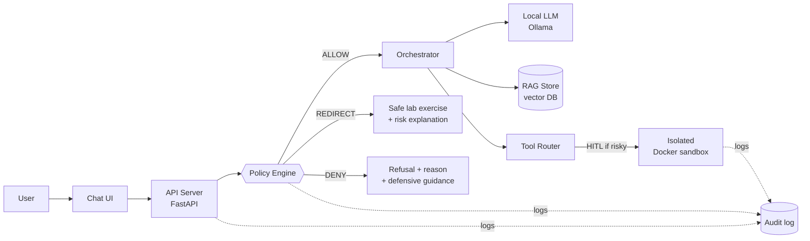

# local-ai-security-copilot
Local AI Security Copilot: A local AI agent for security with RAG, Policy-guarded Tool Execution and isolated Sandbox 

---

## Table of Contents

1. [Overview](#1-overview)
2. [Scope and Ethics](#2-scope-and-ethics)
3. [Architecture](#3-architecture)
4. [System Requirements](#4-system-requirements)
---

## 1. Overview

Local AI Security Copilot is a conversational assistant for **defensive security** tasks in lab and teaching environments. The system runs entirely **locally (local-first)**, needs no Internet connection during operation, and consists of:

- A **local LLM** (via Ollama) behind a *model adapter* layer, so the backend can be swapped for an external API when a comparison baseline is needed.
- A **bilingual Vietnamese–English RAG** pipeline over a security knowledge base, returning answers with source citations.
- A **Policy Engine** that combines rules with an intent classifier and decides `ALLOW` / `REDIRECT` / `DENY`, with a stated reason and a Human-in-the-Loop (HITL) mechanism.
- A **Tool Router** that calls defensive tools (log analysis, configuration checks, pcap summarization, etc.) inside an **isolated Docker sandbox**.
- An **audit log** for accountability, with secret redaction.
- A **test-set and quantitative evaluation framework** covering three axes: RAG quality, guardrail effectiveness, and detection support.

### Research Questions

| ID | Question |
| --- | --- |
| RQ1 | How much does RAG over a bilingual security knowledge base improve answer accuracy and reliability compared with a plain local LLM? |
| RQ2 | How effectively can a Policy Engine block dangerous requests while preserving legitimate defensive tasks? What is the safety–utility trade-off? |
| RQ3 | How well does the Copilot support log and network-traffic triage on standard datasets, comparing the local model with a reference API? |

---
## 2. Scope and Ethics

**In scope:** explaining concepts, analyzing logs and traffic, reviewing defensive configurations and code, suggesting mitigations, supporting basic incident investigation, and assisting with CTFs at a learning level. Red-team-style operations (if enabled) run only against **target machines in a lab built by the team**, with scope checks and a ban on destructive payloads.

**Out of scope. The system does not, and will not:**

- Generate deployable malware/ransomware, weaponized exploits, or automated attack tools aimed at systems outside an authorized scope.
- Scan or attack any real system, third-party infrastructure, or University/Faculty infrastructure without written permission.
- Store or process real credentials, personal data, or production secrets.

> **Note for users and contributors:** use this project only on your own systems or systems you are authorized to test in writing. The authors are not responsible for any misuse.

---

## 3. Architecture

Each request passes through these steps: input normalization → rule layer → intent classifier → (HITL if needed) → execution → output check → response. **Every step is logged.**

| Component | Role | Technology |
| --- | --- | --- |
| Chat UI | Conversation, display of citations and policy status | `<Open WebUI / Streamlit / React>` |
| API Server | Authentication, routing, session management, `/chat`, `/confirm` | FastAPI (Python) |
| Policy Engine | Intent classification, scope checks, ALLOW/REDIRECT/DENY decisions | Rules + intent classifier |
| LLM | Answer generation, reasoning | Ollama: `<chosen model, quantization level>` |
| RAG Store | Knowledge base, embeddings, hybrid retrieval | `<ChromaDB/FAISS>`, bge-m3 |
| Tool Router | Selects and invokes tools according to manifests | Python |
| Sandbox | Runs tools in single-use containers | Docker |
| Logging | JSON audit log, time-limited memory | `<PostgreSQL/SQLite>` + JSONL |

---

## 4. System Requirements

| | Minimum | Recommended |
| --- | --- | --- |
| GPU / VRAM | 8 GB GPU, or CPU-only (slow) | 12–16 GB GPU |
| RAM | 16 GB | 32 GB |
| Disk | 50 GB SSD | 100 GB+ NVMe |
| Operating system | Linux, Windows (WSL2), or macOS | Linux |

Required software: Docker and Docker Compose, Python 3.10+, Git, `make`. If you use an NVIDIA GPU, also install the NVIDIA Container Toolkit.

---

