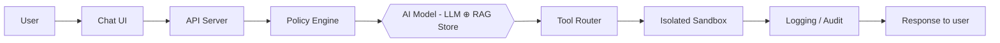

# Building a Local AI Security Copilot

**A locally-operating cybersecurity AI assistant with RAG architecture, policy-guarded tool execution, and an isolated sandbox**

*Chat — Analyze — Detect — Defend*

| Item | Details |
| --- | --- |
| Type | Undergraduate graduation project ("TT tốt nghiệp"), team of 2 students |
| Duration | 6 months |
| Student 1 |Đặng Quang Hưng — Student ID: 23127196 |
| Student 2 | Trần Trọng Hưng — Student ID: 23127374 |
| Supervisor | Senior Lecturer Đỗ Hoàng Cường, M.Sc. |
| Institution | Faculty of Information Technology, University of Science, VNU-HCM |

*Ho Chi Minh City — 2026*

---

## Table of Contents

1. [Project Introduction](#1-project-introduction)
2. [Proposed System Architecture](#2-proposed-system-architecture)
3. [Technology and Hardware Requirements](#3-technology-and-hardware-requirements)
4. [Data and Evaluation Methodology](#4-data-and-evaluation-methodology)
5. [Final Deliverables](#5-final-deliverables)
6. [Expected Results and Success Criteria](#6-expected-results-and-success-criteria)
7. [Installation and Running](#7-installation-and-running)
8. [License](#8-license)

---

## 1. Project Introduction

### 1.1. Research Questions

1. **RQ1 — RAG:** How much does a RAG (Retrieval-Augmented Generation) system built on bilingual (Vietnamese–English) security knowledge improve the accuracy and reliability of answers compared with a plain local LLM?
2. **RQ2 — Policy/Guardrail:** How effectively can a Policy Engine block dangerous requests (generating destructive code, attacking out-of-scope targets) while preserving legitimate defensive tasks? What is the safety–utility trade-off?
3. **RQ3 — Detection:** How effective is the Copilot at supporting log and network-traffic analysis/triage to detect anomalies on standard datasets, when comparing the local model against a reference API?

### 1.2. Objectives

**General objective:** Build and evaluate a complete "Local AI Security Copilot" system that runs locally and integrates RAG + Policy Engine + Tool Router + Sandbox + Logging, serving defensive security tasks in lab/teaching environments, together with a test set and a quantitative evaluation framework.

**Specific objectives:**

- Deploy a local-first LLM and a RAG pipeline over a quality-controlled bilingual security knowledge base.
- Design a Policy Engine that classifies and routes requests (allow / redirect / deny) with reason explanations and HITL.
- Build a Tool Router that invokes defensive security tools (legitimate scans, log analysis, configuration checks) inside an isolated sandbox.
- Set up a memory + logging system for auditing that does not store secrets (credentials, tokens).
- Build a dedicated test set and quantitatively evaluate along three axes: RAG quality, guardrail effectiveness, and detection support.
- Compare the local model against an external API (hybrid) on quality, latency, and cost.

### 1.3. Scope and Limitations

**In scope:**

- Defensive assistant: explaining concepts, analyzing logs/traffic, reviewing defensive configurations and source code, suggesting mitigations, supporting basic incident investigation, supporting CTFs at a learning level.
- Controlled red-team capability: runs only against target machines in a lab/CTF built by the team, with scope verification and a ban on destructive payloads.
- Policy Engine, sandbox (container/VM), audit logging.

**Out of scope — ethical and legal boundaries:**

- **NO** generation of deployable malware/ransomware, weaponized exploits, or automated attack tools aimed at systems outside an authorized scope.
- **NO** attacking/scanning any real system, third-party infrastructure, or University/Faculty infrastructure without written permission.
- **NO** storing or processing real credentials, personal data, or production secrets.

### 1.4. Scientific and Practical Significance

**Scientific:** contributes a quantitative evaluation framework for local AI security assistants, especially the Policy Engine/guardrail component, which is rarely studied rigorously in student projects.

**Practical:** provides a safe teaching and learning tool for the Faculty's cybersecurity courses, runnable on standard lab-room hardware and independent of cloud services.

---

## 2. Proposed System Architecture

### 2.1. Overall Flow

A request passes through the following components in order (every step is logged):



### 2.2. Main Components

| Component | Role | Proposed technology |
| --- | --- | --- |
| Chat UI | Conversation interface, displays source citations and policy status | React.js |
| API Server | Authentication, routing, session management | FastAPI (Python) / Node.js |
| **Policy Engine** | Intent classification, scope checking, allow/redirect/deny decisions, HITL | Rules + intent classifier |
| AI Model | Answer generation, reasoning | Ollama (Llama 3.1 8B / Qwen2.5 7B) |
| RAG Store | Knowledge base + embeddings + retrieval | ChromaDB/FAISS + embedding model |
| Tool Router | Selects and invokes appropriate security tools | LangChain / LlamaIndex |
| **Sandbox** | Isolated environment for running tools | Docker/LXC, disposable VM |
| Logging/Memory | Audit logging; safe context storage | PostgreSQL/SQLite + JSON logs |

### 2.3. Policy Engine Design (core contribution)

Every request is classified and routed along three branches:

| Decision | Condition | System behavior |
| --- | --- | --- |
| **ALLOW** | Legitimate defensive task, within scope | Execute in the sandbox, write a log |
| **REDIRECT** | Ambiguous or borderline intent | Convert into an equivalent safe lab exercise, explain the risk |
| **DENY** | Generates destructive content / out of scope | Refuse, explain, suggest defensive directions |

**Hybrid mechanism:** combines rules (rule-based: tool whitelist, scope/target checks) with an intent classifier. Includes a Human-in-the-Loop mechanism: risky actions require user confirmation before running.

### 2.4. LLM Operating Mode: Hybrid (local-first)

**Local is primary** (security, no network dependence, zero operating cost); **the external API is used only as a reference** for answer quality during evaluation. An abstraction layer (model adapter) lets the backend be swapped without changing the rest of the system.

---

## 3. Technology and Hardware Requirements

### 3.1. Technology Stack

| Layer | Proposed choice |
| --- | --- |
| Language | Python 3.10+ (AI backend), JavaScript/TypeScript (frontend) |
| Backend/API | FastAPI (recommended) or Node.js |
| LLM runtime | Ollama / llama.cpp (local); adapter for OpenAI/Claude/Gemini API (reference) |
| Local model | Llama 3.1 8B-Instruct or Qwen2.5 7B-Instruct (Q4_K_M) |
| Embedding | bge-m3 / multilingual-e5 (Vietnamese support) |
| Vector DB | ChromaDB or FAISS (Qdrant if scaling is needed) |
| Orchestration | LangChain or LlamaIndex |
| Frontend | React.js (chat interface + display of sources & policy) |
| Deployment | Docker Compose (packages the whole system) |
| Storage | PostgreSQL or SQLite (logs & memory) |

### 3.2. Hardware Requirements

Reference VRAM figures for 7–8B models at Q4_K_M quantization: an 8B model runs well on an 8 GB VRAM card (~40 tokens/second), and 12 GB gives more comfortable context headroom.

| Component | MINIMUM configuration | RECOMMENDED configuration |
| --- | --- | --- |
| Goal | Runs, slowness accepted | Smooth experience for demo & evaluation |
| GPU/VRAM | 8 GB GPU (RTX 3060/4060) or CPU-only | 12–16 GB GPU (RTX 4060 Ti 16 GB / 4070) |
| Local model | Qwen2.5 7B / Llama 3.1 8B (Q4) | Same model + longer context / try 14B |
| System RAM | 16 GB | 32 GB |
| Storage | 50 GB SSD | 100 GB+ NVMe SSD |
| Notes | If CPU-only: use a 3–7B Q4 model, low speed | May request a GPU/server from the Faculty for the evaluation phase |

**Hardware fallback plan:** if no sufficiently powerful GPU is available: (1) use a smaller (3–4B) model at Q4 for the local part; (2) use the reference API for experiments that need high quality; (3) propose borrowing a GPU machine from the Faculty for the final evaluation phase. The project remains feasible at the minimum configuration because its focus is architecture + policy + evaluation, not model training.

---

## 4. Data and Evaluation Methodology

### 4.1. Proposed Data Sources

**Knowledge base for RAG:**

- Open technical documents: OWASP (Top 10, ASVS), MITRE ATT&CK documentation, NIST guidelines, tool man pages (nmap, Suricata, iptables, Wireshark).
- The Faculty's course content (lectures, labs, cheat-sheets), already standardized and bilingual Vietnamese–English.
- CTF writeups and technical notes at a learning level (legitimate sources, quality-reviewed).

**Datasets for detection (test set):**

- **CIC-IDS2017 / CSE-CIC-IDS2018:** labeled attack/benign network traffic.
- **UNSW-NB15:** an intrusion detection dataset widely used in research.
- **CERT/UEBA-style synthetic logs:** generated by the team (in the style of existing synthetic data generators), for log triage scenarios.

**Guardrail test set (built by the team):** about 150–300 prompts covering: (a) legitimate defensive requests (must ALLOW), (b) borderline/ambiguous requests (should REDIRECT), (c) dangerous/out-of-scope requests (must DENY), plus attack prompts (prompt injection, jailbreak) to test the policy's robustness.

### 4.2. Evaluation Metrics

| Axis | Metrics | How measured |
| --- | --- | --- |
| **RAG** | Answer accuracy, faithfulness, citation correctness, latency | Reference Q&A set + human evaluation / RAGAS |
| **Guardrail** | Blocking precision/recall, false-positive rate (wrongful blocking), jailbreak success rate | Run on the self-built guardrail test set |
| **Detection** | Accuracy, Precision, Recall, F1 (watch for class imbalance) | On CIC-IDS/UNSW-NB15/synthetic logs |
| **Hybrid** | Quality vs. latency vs. cost (local vs. API) | Compare on the same prompt set |

**Academic highlight:** the Guardrail axis is the highlight: the report clearly presents the safety–utility trade-off (over-blocking reduces usefulness), with analysis of failure cases (error analysis). Few projects do this rigorously, so it is easy to stand out before the committee.

---

## 5. Final Deliverables

1. Complete system source code (packaged with Docker Compose, runs offline).
2. RAG knowledge base + test sets (RAG, guardrail, detection).
3. Thesis report + architecture documentation + policy documentation.
4. Defense slides + live demo script.

---

## 6. Expected Results and Success Criteria

| Expected result | Success criterion (suggested, quantitative) |
| --- | --- |
| A complete, offline-running Copilot system | End-to-end demo on minimum hardware, no Internet required |
| RAG improves answer quality | Higher answer accuracy & citation than the plain LLM (measured on the Q&A set) |
| Effective Policy Engine | High recall in blocking dangerous requests, acceptable false positives, resists most jailbreaks in the test set |
| Detection support | Competitive F1 on standard datasets, with class-imbalance analysis |
| Hybrid local–API comparison | A clear quality/latency/cost trade-off table |

*Specific thresholds for each metric will be set with the supervisor after baseline results at the end of Phase 2, so that goals are achievable yet still challenging.*

---

## 7. Installation and Running

The system is packaged with Docker Compose and runs offline. Detailed installation instructions (downloading models, loading the knowledge base, running evaluations) will be added once the system is complete.

```bash
docker compose up -d
```

---

## 8. License

Not yet determined. Third-party models, datasets, and documents are governed by their respective licenses.
